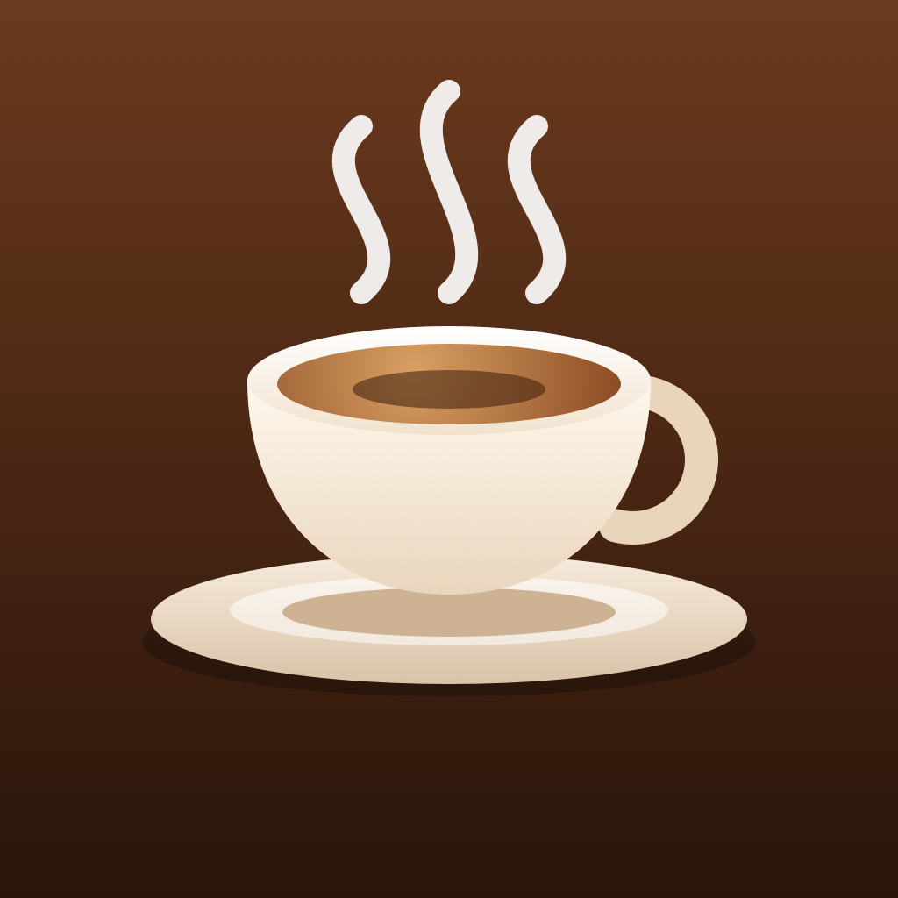

# Triple Espresso
### Keep your Mac awake. Strong and quick.

Triple Espresso is a tiny macOS menu bar app, written entirely in Swift, that stops your Mac from falling asleep while long-running work finishes.

### Usage

An espresso cup sits in the right side of your menu bar. Click it to toggle: a steaming cup means your Mac will not sleep or dim the screen, and an empty cup means it sleeps normally.

Right-click (or Control-click) the cup for the menu: set a timeout, open Preferences, or quit. In Preferences you can start it at launch, pick a default duration, and keep chat apps from showing you as away.

### Building

Requires Xcode and macOS 14.6 or later.

```bash
xcodebuild -project src/TripleEspresso.xcodeproj -scheme TripleEspresso -destination "platform=macOS" build
```

### Credits and license

Triple Espresso is based on [Caffeine for modern macOS](https://github.com/domzilla/Caffeine) by Dominic Rodemer. Caffeine was originally created by Tomas Franzén (2006) and continued by Michael Jones (2018). Released under the MIT License; see [LICENSE](LICENSE).
